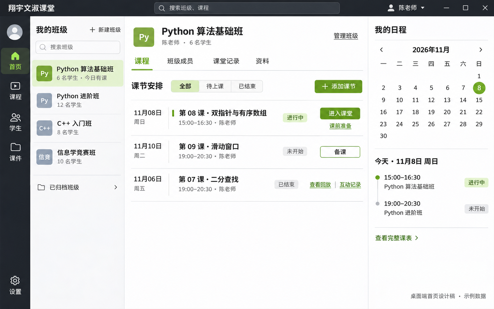
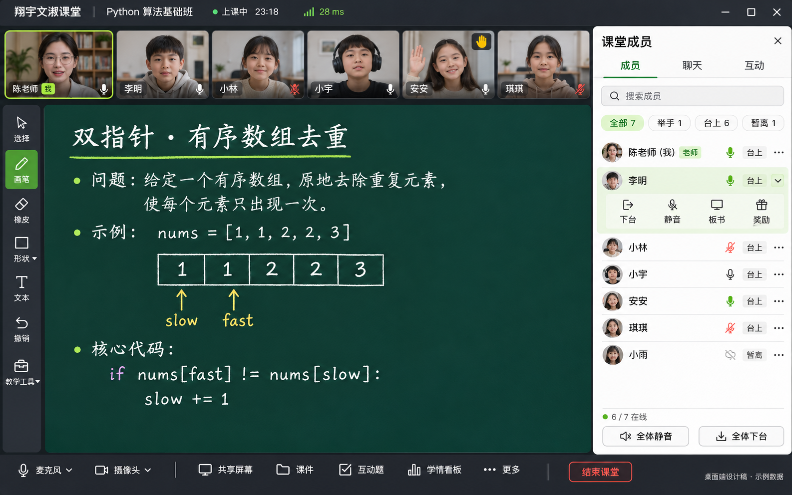
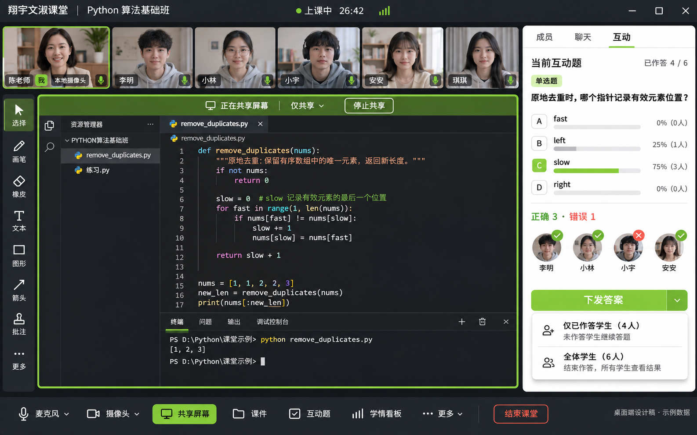
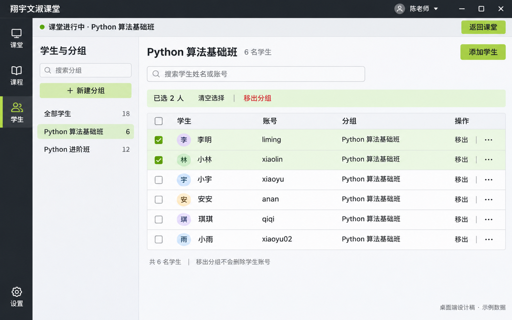

# 桌面客户端 · ClassIn 布局设计 v1

日期：2026-11-08。范围仅为 Electron 桌面客户端，沿用 `feature/classin-client-workspace` 分支。这是高保真设计参考，图片中的人物、数据与状态均为生成示例，不代表当前安装包已实现或实测通过。

## 四个界面

### 00 首页与课程入口

首页按班级组织教学任务：应用导航 → 我的班级 → 当前班级课节 → 我的日程。中间默认显示课节安排，进入课堂、备课、回放和互动记录紧贴对应课节，避免将主要操作分散到统计卡片。右侧日历和当天日程用于跨班级找到近期课程。

- 默认选中最近访问的有效班级；没有记录时优先选择当天有课的班级。教师和学生都只展示有权限访问的班级。
- 有正在进行的课堂时显示“返回课堂”；尚未进入时显示“进入课堂”。切换班级不应停止正在运行的媒体课堂。
- 标题区“课程”表示当前班级内课节，应用导航“课程”表示跨班级课程列表；实现时应通过标题和选中状态区分作用域。
- 日期、星期、课堂状态、日程和人数全部由真实数据计算，不能写死生成图中的示例。时间采用用户时区，日历需使用日期组件，不能照搬图片排版数字。
- 新建班级、添加课节、备课和管理班级仅按现有权限开放；尚未具备接口的归档、资料等入口在实现时应隐藏或显示明确不可用状态。
- 1280px 以下先收起右侧日程，保留课表按钮；1024px 时班级列支持折叠，保持课节标题和进入课堂入口可见。
- 生成图中的绿色按钮在代码实现时统一采用深色文字，以满足正文对比度要求。

### 01 课堂与成员面板

采用标题栏、顶部座位席、大黑板和教学工具栏的结构。教师自己的摄像头位于第一席，以“我”标识。课堂成员直接在侧栏筛选和管理，避免另开管理页面遮挡课堂。教师、举手、台上、暂离状态清晰区分，单人操作展开后显示下台、静音、板书与奖励。

### 02 共享屏幕与互动题

“仅共享”状态也保留第一席的本地摄像头预览。共享内容占据中央舞台，工具和预览不覆盖代码正文。右侧互动面板承载题目分布和作答头像，头像右上角显示正确/错误结果；答案下发明确区分仅已作答与全体学生，并说明是否继续答题。实现时必须由教师授权决定是否向学生公开正确答案；图中答案与统计属于教师视图。

### 03 课外学生与分组

使用应用导航、分组导航和学生表格三层结构。课堂运行提示和“返回课堂”持续可见。批量选择操作紧贴表格；移出分组需确认，并说明不会删除账号。“全部学生”应定义为当前教师可管理分组的去重学生合集，当前接口未提供的目录能力不能伪装成真实数据。

## 实现规范

- 课堂采用深色工具区域与绿色黑板，课外管理采用浅色列表，保留一致的导航和强调色。
- 主色：窗口 `#20252B`、黑板 `#173D35`、强调 `#9BCB53`、正文 `#22282D`、浅色底 `#F4F5F6`。生成图颜色只作参考，代码以这些数值为准。
- 亮绿色按钮使用深色文字；生成图中绿色按钮白字的部分在实现时修正，正常文字对比度至少 4.5:1。选中状态同时使用图标/描边，不只依赖颜色。
- 以 1440×900 为主要逻辑画布。标题栏约 40px，视频席约 128px，工具栏 56–64px，课堂侧栏约 300–320px，底部控制区约 64px。这些为逻辑尺寸，不是生成图片像素值。
- 在 1024px 宽度下收起侧栏、横向滚动座位；成员/聊天/互动同时只展开一个面板。避免缩小整套界面导致文字不可读。
- 字体使用系统中文字体，正文 14–16px，关键点击区域至少 36px。功能按钮有名称、悬停提示、键盘焦点和禁用状态。
- 镜头预览绑定本地 camera track；共享画面绑定 display track，停止共享不应移除 camera track。
- 管理命令继续经过现有固定 IPC、课次与权限校验，弱网下保留列表和操作状态。连接失败显示“同步暂未确认”，不能把失败伪装成成功。
- 本轮只交付设计图片和规范，不修改桌面运行界面，也不涉及移动端、网页或服务端。

## 依据与生成记录

参考 ClassIn 官方 [教室结构](https://docs.eeo.cn/product/zh-hans/function/ClassInjiaoshi.html) 的标题栏、座位席、工具栏与黑板布局，以及 [班级管理](https://docs.eeo.cn/product/zh-hans/function/3ClassInIM.html) 的成员组织方式；保留本项目品牌，不使用 ClassIn 标识。

图片使用内置 `image_gen` 工具生成。[完整生成提示词](prompts.md) 随设计保存。PNG 是视觉参考，实施时需要用真实组件、图标和视频流还原，不能把整张图片作为应用界面。
