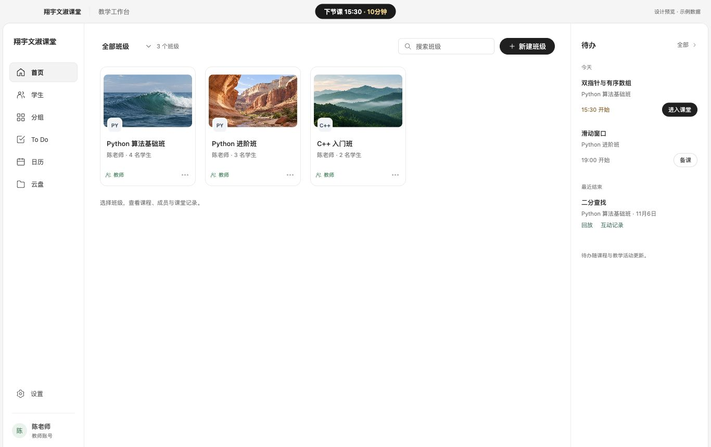
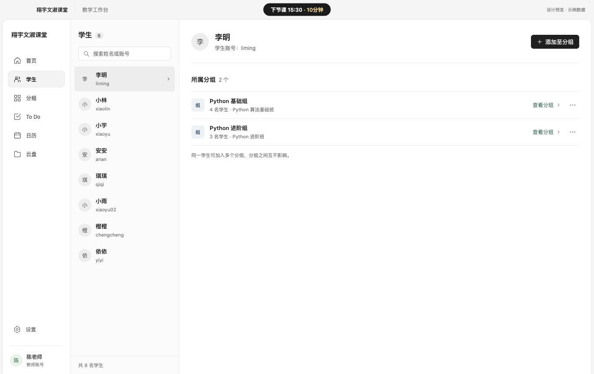
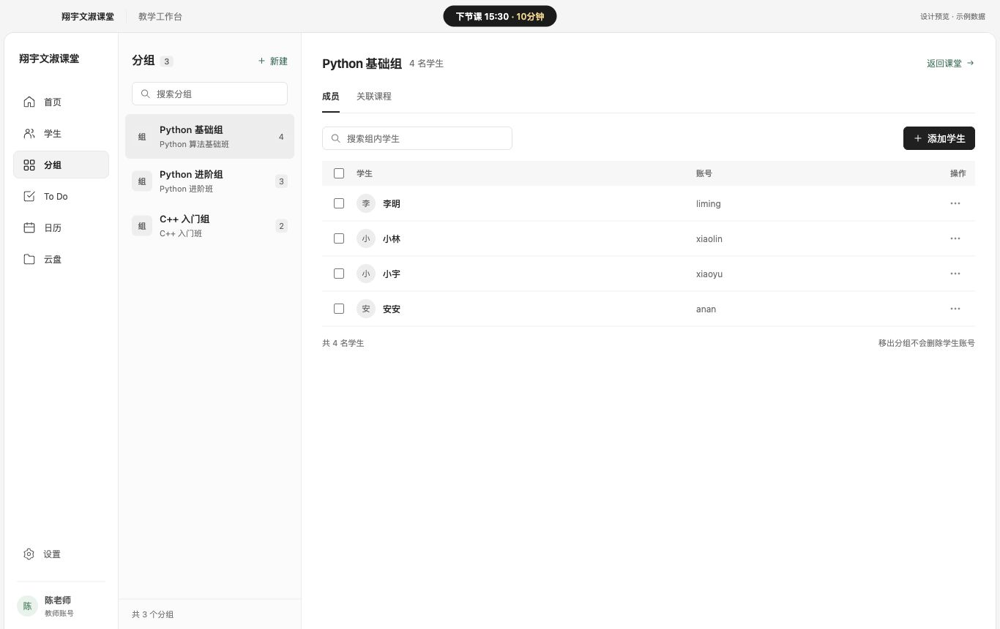
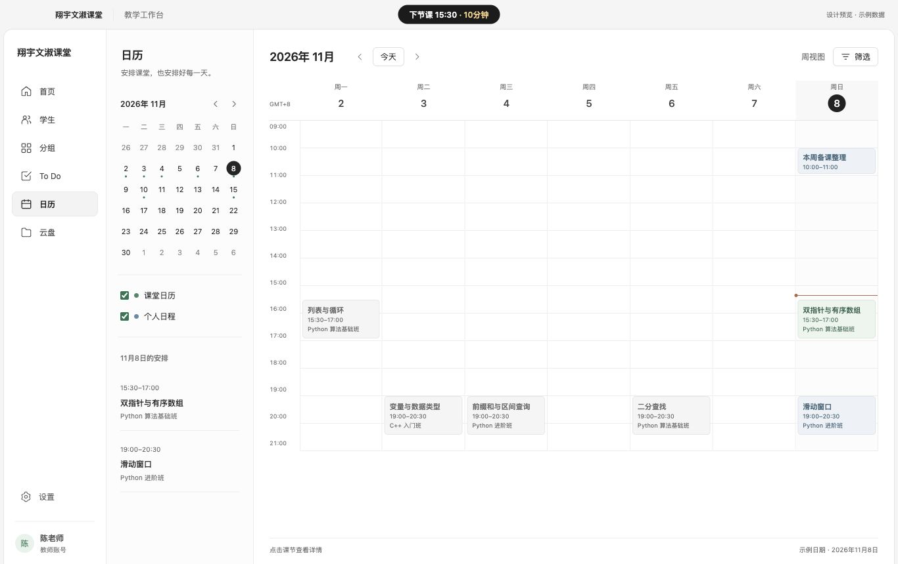
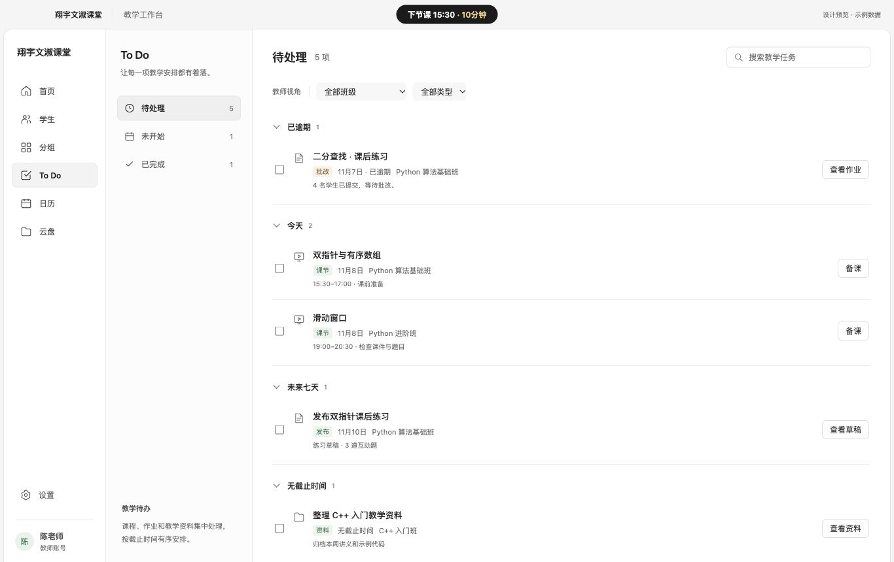
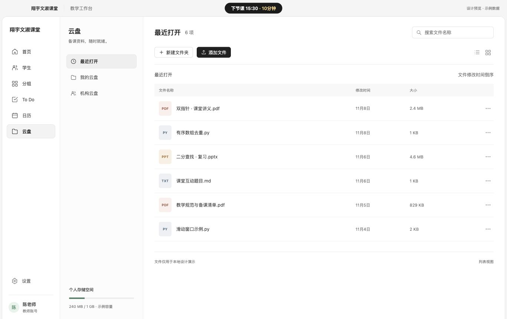
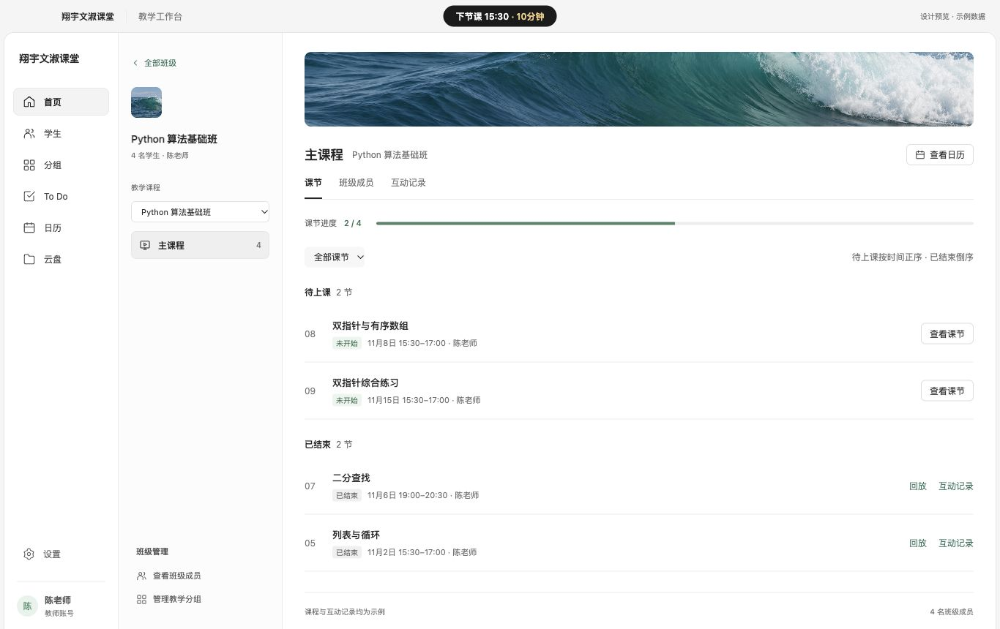

# ClassIn 实拍参照 · 桌面设计原型 v5

2026-11-08。依据用户要求，先截取当前 ClassIn Mac 登录首页，再重做首页、学生和分组；随后根据其他页面调研补齐日历、To Do、云盘和课节。保留真实 PC 字号，用独立 Electron 与浏览器预览展示，未修改生产课堂入口、网页、移动端或服务端。

## 设计依据

- 首页依据当前官方 Apple Silicon 包登录后的原生截图：浅色侧栏，中间班级封面卡片，右侧待办，顶部临近课堂入口及黑色主操作。
- 学生与分组的操作组织参考 ClassIn 发布者公开教程；原生自动点击无法控制 ClassIn 窗口，不能将这两部分说成当前版本完整实测。
- 本机原始截图位于 `outputs/classin-research-2026-11-08/native-home-reference.jpg`，含真实账号信息，不随 Git 提交。公开来源与观察记录见 [调研文档](../../research/classin-2026-11-08/README.md)。

## 预览

```bash
cd clients/desktop
npm ci
npm run design:preview
```

独立 Electron 窗口为 1366×860，缩放 100%；临时浏览器预览为 `http://127.0.0.1:3183/`。也可直接打开 [index.html](index.html)。原型不请求生产接口，所有操作仅改变内存中的示例数据，刷新恢复。进入课堂、实际备课、回放与设置为明确的示例入口，不会连接真实音视频。代码和 Markdown 文件可查看内置示例文本；PDF/PPT 目前显示文件信息，不提供完整文档渲染。

直接入口：`/#calendar` 日历、`/#todo` To Do、`/#files` 云盘、`/#courses` 课节。页面内通过导航和班级入口切换。

## 首页



默认对象改为班级；课表从独立入口进入。班级提供筛选、搜索和新建，点击班级进入课程、成员和互动记录。右侧待办放置临近课节与近期回放入口。使用颜色识别封面，避免把整条导航和操作区染成高饱和底色。

## 学生



左侧名单，右侧账号与所属分组，查看个人后再执行相关操作。没有照搬社交好友与邀请权限。学生目录按当前示例班级成员和分组成员去重；分组移出不删除账号。

## 分组



按集合管理学生，保留关联课程上下文。选中成员后显示批量条，移出需要确认。班级成员名单与分组成员独立，不能因修改分组而静默修改班级报名。这与 ClassIn 教学分组方案仍有业务区别；当前设计不宣称实现随机分组、组长或多套分组方案。

## 尺寸与样式

正文与班级标题 13px；详情标题 17–18px；表格 12px、行高 48px；次要说明 10–12px。初始侧栏 156px，1024px 视口下为 144px；首页右侧待办分别为 264px / 220px。主操作 #202020，正文 #252525，底色白/浅灰，角色与选择状态使用克制的绿色。系统字体、统一线性图标与可见键盘焦点。

1366px、1024px 视口均实测，无主区域横向溢出。检查截图：[1024 首页](verification-1024-home.jpg)、[1024 分组](verification-1024-groups.jpg)。封面载入、班级进入课程、成员切换、互动记录入口、新建空班级、班级搜索、分组确认移出均已操作验证；移出分组后班级成员仍保持原人数。控制台未发现错误或警告。

## 原创素材

封面为内置 image_gen 生成的原创示例，仅用于演示班级识别，不拷贝 ClassIn 账号资料、照片或标识。文件：[海面](assets/ocean.png)、[峡谷](assets/canyon.png)、[山林](assets/forest.png)；完整提示词见 [asset-prompts.md](asset-prompts.md)。界面截图来自真实渲染，未用图像生成模拟字号。

## 日历



左侧小月历、课堂/个人日程开关和选中日期安排，主体是周时间网格。支持前后周/月、回到今天、班级筛选和课节详情。默认示例日期为 2026 年 11 月 8 日，顶部临近课程和当前时间线也为固定示例；不暗示它们是实时状态。课程颜色对应班级类型，已结束课节使用灰色。

## To Do



二级导航提供待处理、未开始、已完成及数量。支持班级、类型筛选和任务搜索；待处理按截止时间分组，完成项统一放入“完成记录”，避免把完成项误标为逾期。勾选和恢复仅改变示例任务状态，不代表已批改、发布考试或完成真实作业。首页待办“全部”进入完整 To Do。

## 云盘



最近打开、个人和机构分类，配合文件列表/网格、文件夹导航、文件信息面板及预览。支持新建本地示例文件夹；机构资料为只读示例。添加文件只记录用户所选文件的名称、大小等元数据，不读取文件内容或上传文件。文件夹优先，同类按日期倒序、名称排序。最近打开为固定示例集合，容量也为示例值。

## 课节



班级入口进入主课程，左侧切换班级，主体显示课节进度、待上课和已结束课节，后两者分别按时间正序、倒序。支持状态筛选、课节详情、日历联动，以及班级成员、分组和互动记录入口。当前每班仅有一个主课程示例，互动正确率为演示数值；没有接入真实学情或学生数据权限。

## 本轮验证

- JavaScript 语法检查通过；现有桌面客户端安全与人员操作契约测试 4 项通过。
- 浏览器中实测日历班级筛选和详情、To Do 完成/恢复和筛选及空搜索、云盘进入文件夹/新建文件夹/文本预览/网格切换、课节成员及互动记录切换。
- 1366×860 和 1024×768 共 8 个页面布局实测，正文计算字号 13px，文档与主内容区均无横向溢出；控制台无错误或警告。
- 窄窗口截图：[日历](verification-1024-calendar.jpg)、[To Do](verification-1024-todo.jpg)、[云盘](verification-1024-drive.jpg)、[课节](verification-1024-lessons.jpg)。另有 [完成任务分组](verification-todo-completed.jpg)。
- Electron 预览启动命令已运行；原生自动化选择到了旧版 Electron 窗口，不能把本轮浏览器截图写成新版原生窗口实测截图。

新增页面继承现有首页系统，不改变其配色和字号方向；所有发布者截图仅作为 [调研依据](../../research/classin-2026-11-08/other-pages.md)，不作为应用素材使用。
