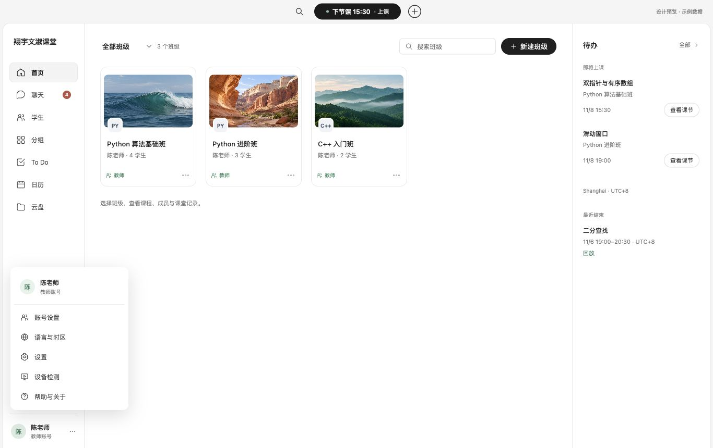
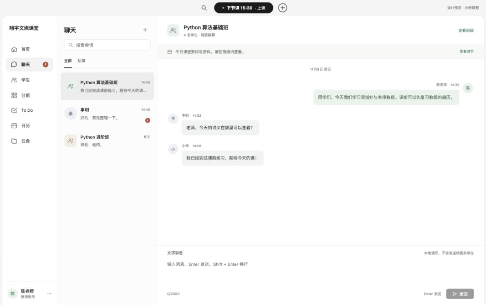
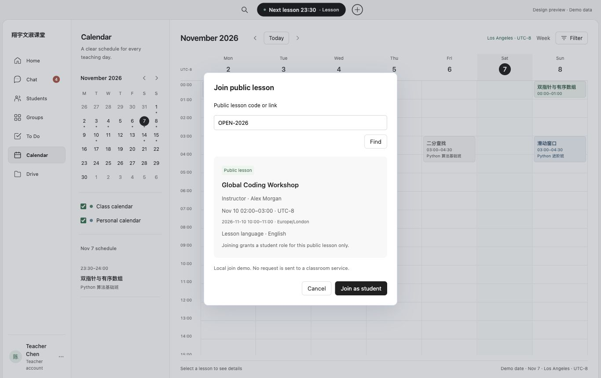
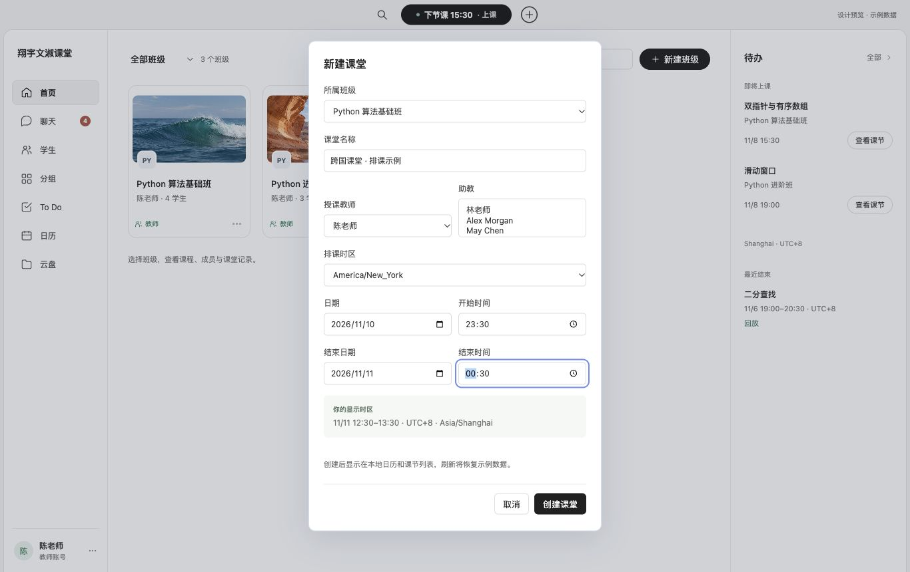
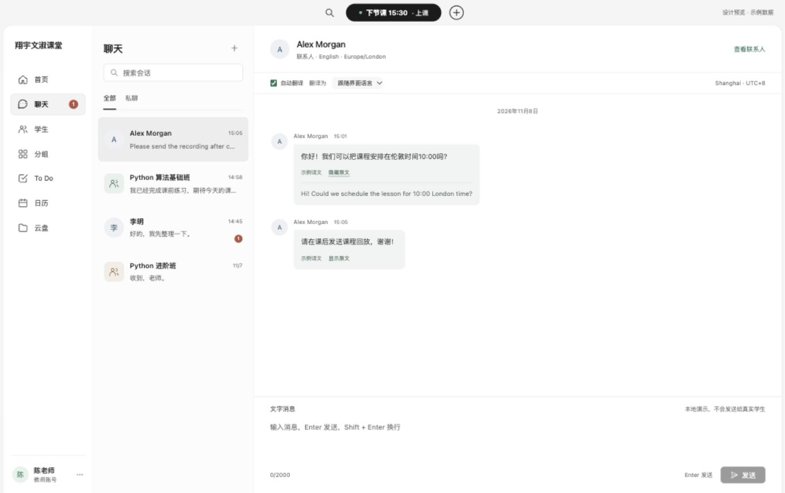
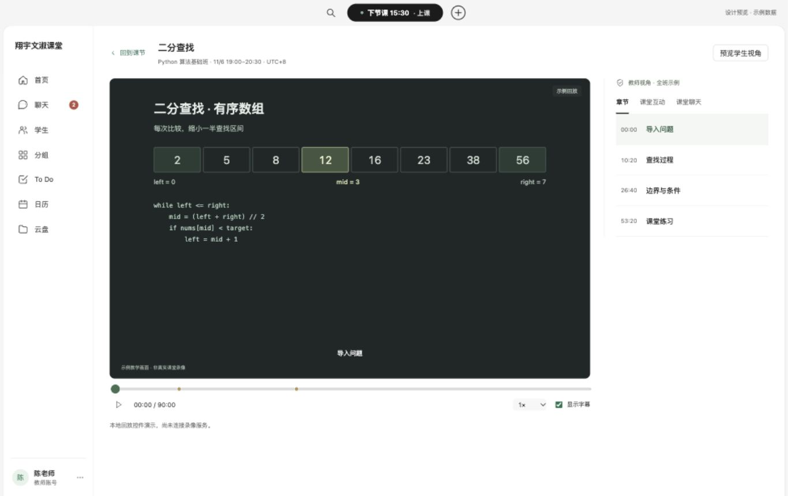
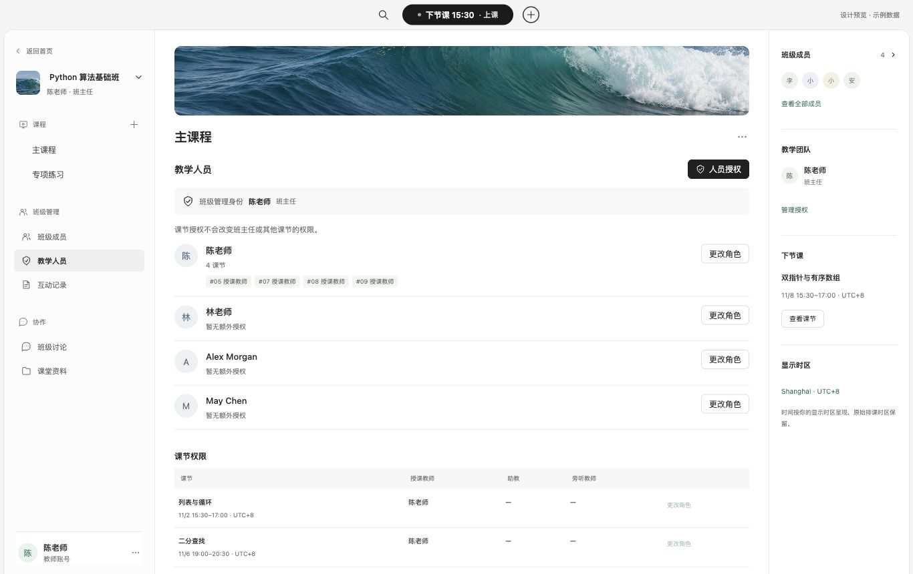
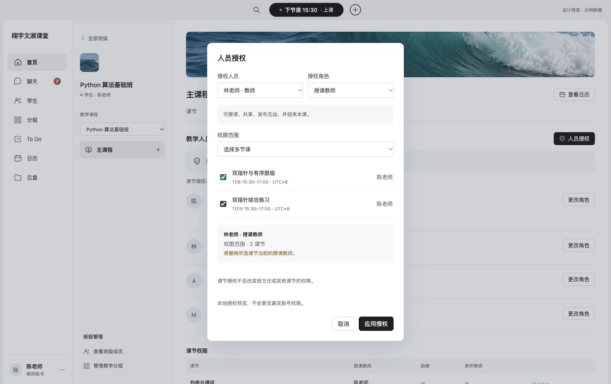
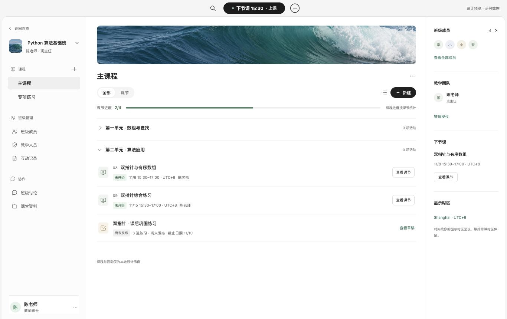
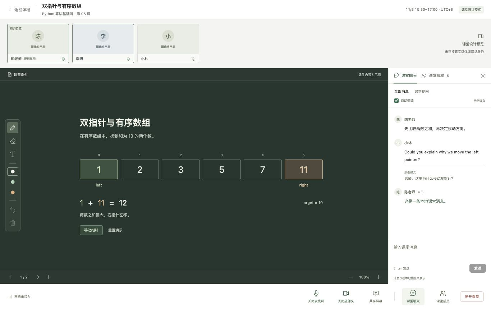

# ClassIn 实拍参照 · 桌面设计原型 v5

2026-11-08。依据用户要求，先截取当前 ClassIn Mac 登录首页，再重做首页、学生和分组；随后根据其他页面调研补齐日历、To Do、云盘和课节。保留真实 PC 字号，用独立 Electron 与浏览器预览展示，未修改生产课堂入口、网页、移动端或服务端。

## 设计依据

- 首页依据当前官方 Apple Silicon 包登录后的原生截图：浅色侧栏，中间班级封面卡片，右侧待办，顶部临近课堂入口及黑色主操作。
- 学生与分组的操作组织参考 ClassIn 发布者公开教程；原生自动点击无法控制 ClassIn 窗口，不能将这两部分说成当前版本完整实测。
- 本机原始截图位于 `outputs/classin-research-2026-11-08/native-home-reference.jpg`，含真实账号信息，不随 Git 提交。公开来源与观察记录见 [调研文档](../../research/classin-2026-11-08/README.md)。

## 预览

```bash
cd clients/desktop
npm ci
npm run design:preview
```

独立 Electron 窗口为 1366×860，缩放 100%；临时浏览器预览为 `http://127.0.0.1:3183/`。也可直接打开 [index.html](index.html)。原型不请求生产接口，所有操作仅改变内存中的示例数据，刷新恢复。进入课堂、实际备课、回放与设置为明确的示例入口，不会连接真实音视频。代码和 Markdown 文件可查看内置示例文本；PDF/PPT 目前显示文件信息，不提供完整文档渲染。

直接入口：`/#calendar` 日历、`/#todo` To Do、`/#files` 云盘、`/#courses` 课节与教学人员、`/#chat` 聊天、`/#replay` 回放。页面内通过导航和班级入口切换。

## 首页


默认对象改为班级；课表从独立入口进入。班级提供筛选、搜索和新建，点击班级进入课程、成员和互动记录。右侧待办放置临近课节与近期回放入口。使用颜色识别封面，避免把整条导航和操作区染成高饱和底色。

## 学生


左侧名单，右侧账号与所属分组，查看个人后再执行相关操作。没有照搬社交好友与邀请权限。学生目录按当前示例班级成员和分组成员去重；分组移出不删除账号。

## 分组


按集合管理学生，保留关联课程上下文。选中成员后显示批量条，移出需要确认。班级成员名单与分组成员独立，不能因修改分组而静默修改班级报名。这与 ClassIn 教学分组方案仍有业务区别；当前设计不宣称实现随机分组、组长或多套分组方案。

## 尺寸与样式

正文与班级标题 13px；详情标题 17–18px；表格 12px、行高 48px；次要说明 10–12px。初始侧栏 156px，1024px 视口下为 144px；首页右侧待办分别为 264px / 220px。主操作 #202020，正文 #252525，底色白/浅灰，角色与选择状态使用克制的绿色。系统字体、统一线性图标与可见键盘焦点。

1366px、1024px 视口均实测，无主区域横向溢出。检查截图：[1024 首页](verification-1024-home.jpg)、[1024 分组](verification-1024-groups.jpg)。封面载入、班级进入课程、成员切换、互动记录入口、新建空班级、班级搜索、分组确认移出均已操作验证；移出分组后班级成员仍保持原人数。控制台未发现错误或警告。

## 原创素材

封面为内置 image_gen 生成的原创示例，仅用于演示班级识别，不拷贝 ClassIn 账号资料、照片或标识。文件：[海面](assets/ocean.png)、[峡谷](assets/canyon.png)、[山林](assets/forest.png)；完整提示词见 [asset-prompts.md](asset-prompts.md)。界面截图来自真实渲染，未用图像生成模拟字号。

## 日历


左侧小月历、课堂/个人日程开关和选中日期安排，主体是周时间网格。支持前后周/月、回到今天、班级筛选和课节详情。默认示例日期为 2026 年 11 月 8 日，当前时间线为固定示例；顶部上课提示从示例数据中选取该日期起最早的待上课课节，不代表实时上课状态。新建的早间或晚间课节可自动扩展时间网格范围。课程颜色对应班级类型，已结束课节使用灰色。

## To Do


二级导航提供待处理、未开始、已完成及数量。支持班级、类型筛选和任务搜索；待处理按截止时间分组，完成项统一放入“完成记录”，避免把完成项误标为逾期。勾选和恢复仅改变示例任务状态，不代表已批改、发布考试或完成真实作业。首页待办“全部”进入完整 To Do。

## 云盘


最近打开、个人和机构分类，配合文件列表/网格、文件夹导航、文件信息面板及预览。支持新建本地示例文件夹；机构资料为只读示例。添加文件只记录用户所选文件的名称、大小等元数据，不读取文件内容或上传文件。文件夹优先，同类按日期倒序、名称排序。最近打开为固定示例集合，容量也为示例值。

## 课节


班级入口进入课程工作区，左侧切换班级与同班多个课程，主体显示课节进度、教学活动，以及待上课/已结束课节。按时间查看时，后两者分别正序、倒序。支持状态筛选、课节详情、日历联动，以及班级成员、分组和互动记录入口。主课程和专项练习为同班不同课程示例，互动正确率为演示数值；没有接入真实学情或学生数据权限。

## 本轮验证

- JavaScript 语法检查通过；现有桌面客户端安全与人员操作契约测试 4 项通过。
- 浏览器中实测日历班级筛选和详情、To Do 完成/恢复和筛选及空搜索、云盘进入文件夹/新建文件夹/文本预览/网格切换、课节成员及互动记录切换。
- 1366×860 和 1024×768 共 8 个页面布局实测，正文计算字号 13px，文档与主内容区均无横向溢出；控制台无错误或警告。
- 窄窗口截图：[日历](verification-1024-calendar.jpg)、[To Do](verification-1024-todo.jpg)、[云盘](verification-1024-drive.jpg)、[课节](verification-1024-lessons.jpg)。另有 [完成任务分组](verification-todo-completed.jpg)。
- Electron 预览启动命令已运行；原生自动化选择到了旧版 Electron 窗口，不能把本轮浏览器截图写成新版原生窗口实测截图。

新增页面继承现有首页系统，不改变其配色和字号方向；所有发布者截图仅作为 [调研依据](../../research/classin-2026-11-08/other-pages.md)，不作为应用素材使用。

## 顶部快捷入口与左下角账号



按照 ClassIn 的组织方式，顶部中央采用“全局搜索—上课提示—加号”。加号展开新建课堂/新建班级；上课提示打开对应课节详情。新建课堂表单选择班级、名称、日期和起止时间，检查必填与时间顺序后，联动本地日历、课节和待办。全局搜索支持查找班级、学生和会话。

设置从独立侧栏入口收进左下角“陈老师”的账号浮层，包含账号设置、设置、设备检测和帮助与关于。点击外部可收起，再次点击账号可重新展开。设置展示为只读示例，不更改账号、系统偏好或设备权限。另见 [顶部新建菜单](10-quick-create.jpg)。

## 聊天



侧栏新增聊天及未读数量。左侧会话列表支持搜索、全部/私聊切换和发起聊天；右侧显示班级群聊或学生私聊，班级会话可进入课节，学生详情也提供“发消息”入口。

文字消息支持本地展示，切换会话会保留各自草稿；输入空白时禁用发送，发送后清空草稿并定位最新消息；同一会话搜索重绘保留历史阅读位置，重新打开会话时定位最新内容。代码包含 Enter 发送、Shift+Enter 换行与输入法组合态保护。所有消息、未读数和时间都是示例或本地状态，不连接真实学生，也不持久化到云端。未接入附件、语音或真实消息同步。

本轮在 1366×860、1024×768 下检查聊天与账号菜单，正文 13px，无横向溢出；已实测账号菜单外部收起/重开、设置弹窗、顶部新建表单必填及时间校验、早间新课节展示、全局搜索、学生进入私聊、会话草稿保留、本地发送及长会话滚动位置。长会话实测：发送/重新打开后距底部 0px，阅读历史消息再搜索重绘后仍保留原滚动位置。键盘发送组合的保护逻辑已实现，但未宣称完成输入法实机测试。现有桌面契约测试 4 项及 3 个脚本语法检查通过，浏览器控制台无错误或警告。窄窗口截图：[聊天](verification-1024-chat.jpg)、[账号菜单](verification-1024-account.jpg)。

## 公开课加入



顶部加号新增“加入公开课”。输入示例口令 `OPEN-2026` 或示例链接 `https://classroom.example/public/OPEN-2026`，先核对讲师、语言、本地时间和原排课时区，再以学生身份加入。其他口令显示未找到；示例链接不发起网络请求。重复加入不会创建重复班级。加入公开课不赋予教学授权权限，公开课学生界面不提供分组管理操作。

## 国际化与跨时区排课



左下角账号菜单新增“语言与时区”，支持中文/英文界面与九个 IANA 显示时区，用户编写的课程名称和消息保留原语言。预览界面字典位于 `international.js`；这是桌面原型的字典实现，未将网站或移动端国际化。语言和时区保存在内存中，刷新恢复默认设置。

排课单独指定原始时区及开始/结束日期，记录 `startsAt`/`endsAt` UTC 时间点和 `sourceTimeZone`，显示区切换不会重排课程。日历、顶部提示、课节详情、待办、公开课与回放时间跟随显示时区；聊天日期和时间也由消息时间点换算。跨午夜课节在日历分两段显示；与示例当前年份不同的日期带年份。无具体时间的任务截止日期保留全天日期语义。

采用 `Intl` 的 IANA 规则计算各日期偏移，拒绝夏令时不存在的时间；遇到重复时间才显示“第一次/第二次”选择。单节时长限制24小时。排课预览显示另一显示区中的实际时段，并保留原始排课时间供核对。排课时可指定教师和多位助教，教师不能兼任同课助教。

本地时间转换依据浏览器内置时区数据库；生产接入时仍需要服务端校验、持久化与权威时区库，不能把当前内存模型视为已上线排课服务。

## 聊天自动翻译设计



新增示例国际联系人 Alex Morgan。外语来信可按界面语言或指定中/英文目标自动展示示例译文，支持展开/收起原文、关闭自动翻译。消息时间和日期跟随显示时区，联系人时区保持独立展示。

**翻译仅为有限的本地 fixture**，每条译文明确标记“示例译文”；未知译文显示“翻译服务待接入”，没有调用模型、传输聊天内容或收取翻译费用。生产实现需要翻译请求状态、失败重试与缓存、原文完整保留，以及明确的语言识别和隐私设置。本轮不宣称具备任意消息实时翻译能力。

## 课程回放页面



已结束课节与首页回放入口进入独立页面。包含教学画面、播放/暂停、进度、章节跳转、互动标记、倍速、字幕，以及互动和课堂聊天侧栏；另有回放处理中/暂无回放的状态。当前教学图与播放器计时是本地演示，不是真实课堂录像，也没有音轨或网络媒体流。

教师预览展示全班示例记录，学生预览固定为李明，只呈现其作答及自己/教师的相关聊天，不显示其他学生的作答。源数据仍是客户端演示数据；实际记录权限必须由服务端鉴权，不能以此预览开关代替真实权限控制。参见 [学生记录截图](verification-replay-student.jpg)。

## 单课／多课教学授权





班级内增加“教学人员”，与班级成员互相连通，课节详情也有授权入口。可选择已有教学人员，为单节或多节未结束课节授予授课教师、助教、旁听教师角色。授课教师为每课一个，批量替换前显示明确提醒；助教和旁听授权可撤销。同一个人不能同时占用同课教师与助教角色。

班主任作为班级管理身份独立展示，课节授权不会更改班主任或未选中的课节。角色权限说明区分授课和结束本课、协助教学、仅旁听；已结束课节的角色只读。此权限矩阵是本项目的设计提案，不宣称与 ClassIn 的所有版本完全一致。参考依据见 [角色调研](../../research/classin-2026-11-08/international-and-roles.md)。

授权操作仅修改本地演示对象，未改变任何真实账号权限。生产实现需校验操作者与人员资格、每节课范围、角色互斥、授权审计及撤销，不应简单把账号全局改为教师。

## 本轮国际课堂验证

- 共9项测试通过：4项既有客户端契约测试，以及跨国日期换算、DST跳时拒绝、DST重复时间选择、跨午夜分段、按课节日期计算夏令时偏移等5项测试。
- 实测纽约 `2026-11-10 23:30` 排课在上海显示为 `2026-11-11 12:30`；原始纽约排课信息保留。洛杉矶显示区中的跨午夜课节分两天显示，聊天日期相应回退至11月7日。
- 实测春季DST不存在时间被阻止创建；未来纽约夏季课的 To Do 显示 `UTC-4`，冬季课显示 `UTC-5`，没有使用当前日期偏移替代课节日期偏移。
- 实测公开课错误口令、正确口令加入和学生授权限制；聊天译文/原文；回放章节跳转和教师8条/学生2条作答范围；教师批量授权仅更改所选两课，单课助教可添加/撤销，历史课和班主任身份不变。
- 在1366×860及1024×768下检查中/英文回放、日历、排课、翻译和人员授权。正文13px，已检查页面无横向溢出；排课和授权弹窗操作区在窄窗口内可见。脚本语法检查、资源链接检查通过，控制台无错误或警告。
- 验证截图：[英文日历](verification-1024-english-calendar.jpg)、[英文回放](verification-1024-english-replay.jpg)、[窄窗口授权](verification-1024-roles.jpg)、[窄窗口排课](verification-1024-schedule.jpg)、[按日期计算DST偏移](verification-dst-task.jpg)。

## 进入班级后的 ClassIn 式课程工作区



参考 [ClassIn 课程创建说明](https://classin.vn/huong-dan/tao-khoa-hoc-va-lop-hoc-tieu-chuan-tren-classin/) 和 [课节列表说明](https://classin.vn/huong-dan/xem-danh-sach-bai-hoc-tren-classin/) 的公开截图与层级：班级下有多个课程，每个课程组织自己的课节与学习活动；右侧提供成员摘要。这里不是当前 Mac 原生课程页的实测还原，未复制发布者图片作为界面素材。

进入班级后收起工作台导航，使用独立的三栏组织：左侧是班级切换、课程目录、班级管理和讨论/资料；中间是选中课程的封面、全部活动/课节切换、进度与内容；右侧常驻班级学生摘要、教学团队、下一课节和时区。左上返回首页，左下账号菜单继续可用。正文13px，沿用浅色底、黑色主按钮与少量状态色。

“全部”按单元展示课节、资料和作业草稿；“课节”集中展示上课、回放、互动记录与状态筛选，也可切换按课次排序。新建课程、关联云盘中的示例文件、保存作业草稿均可操作；资料预览沿用既有文件预览边界。作业草稿不会发布给真实学生。

新增 `programId` 作为同班课程的内容归属。排课、从日历进入课节、回放返回均保留课程上下文；新课程的内容不混入主课程。右侧成员和团队仍属于班级；内容、课节与进度属于选中课程。人员授权继续针对班级内明确选择的课节，不会因切换课程目录而提升全局权限。

本轮实测课程创建、作业草稿、资料关联、课程内容隔离、排课与日历返回、回放返回、账号菜单、成员与授权入口。已修复从“课堂资料”新建作业后仍停留在资料筛选的缺口，保存后切回当前课程全部活动，草稿立即可见。证据：[资料页创建草稿](verification-course-resource-draft.jpg)。

1366×860 和1024×768中/英文布局检查无横向溢出，正文计算字号13px；9项现有客户端及时间测试、脚本语法与资源链接检查通过。截图：[1024全部活动](verification-1024-course-workspace.jpg)、[1024课节](verification-1024-lessons.jpg)、[1024英文](verification-1024-english-course.jpg)、[1024教学人员](verification-1024-staff.jpg)。

所有新增课程和活动仍只存内存，刷新恢复；尚未对接课程、作业发布或真实课堂服务。

## 进入课堂后的教学界面



从未开始课节的“进入课堂”按钮，或课节详情进入；独立顶栏保留班级、课次和按显示时区投影的时间，返回时保留课程上下文。参考 [ClassIn 公开课堂结构](https://classin.vn/huong-dan/cau-truc-lop-hoc-ao/) 与 [聊天说明](https://classin.vn/huong-dan/su-dung-chatbox/)，来源与调整记录见 [教学界面调研](../../research/classin-2026-11-08/teaching-room.md)。

- **白板**：深绿教学舞台、紧凑批注工具、三色画笔、点选擦除、文字批注、撤销、清空当前页批注、逐页独立状态、空白页新增、缩放与适合窗口。双指针示例从12逐步移动至10，找到答案后停用“移动指针”。
- **摄像头**：顶部常驻教师自览和上台学生示意，关闭状态与静音图标清晰区分；“仅共享”和“共享＋人像”模拟均保留顶部自览，后者另有舞台人像位置。
- **聊天**：消息/提问独立草稿和记录；Enter发送、Shift+Enter换行；切换面板保留草稿和滚动位置，发送后定位最新消息。已提供中/英文固定译文的示例消息遵循全局翻译目标，原文保留；新消息不伪造自动翻译。
- **成员**：搜索、单人和全体静音、邀请上台/移下讲台、临时白板权限状态和学生发言开关。最多三名学生同时上台；不会改变课节授课角色或班级身份。学生身份进入时不展示教师管理操作。

布局使用系统字体，基础字号13px，聊天与成员文字11px，操作与辅助文字8–11px；桌面1366×860与1024×768可操作，侧栏可收起扩大舞台。设计预览中的媒体按钮和成员操作仅改变内存示例状态，未采集摄像头/麦克风/屏幕，未向真实学生发送消息，也未实现服务端权限、RTC或弱网同步。刷新恢复示例。

本轮验证：白板页间批注隔离、文字批注、指针示例、画笔点画/定点擦除、撤销/清空、新增空白页、缩放；聊天草稿/发送与提问、成员搜索/静音/上台/书写状态、两种共享预览和侧栏收起；中英文两种桌面尺寸及课程入口。连续自由笔划拖动未通过自动化验收；真实媒体与多端课堂未测试。9项现有客户端/时区测试、所有脚本语法检查通过，浏览器控制台未出现错误或警告。

截图：[成员面板](20-classroom-members.jpg)、[共享＋人像](21-classroom-share-preview.jpg)、[1024成员](verification-1024-classroom-members.jpg)、[1024仅共享](verification-1024-classroom-share.jpg)、[1024英文](verification-1024-english-classroom.jpg)。

收尾复核的两项问题均已解决：笔记代码使用真实换行，见 [1024课堂笔记](verification-1024-classroom-notes.jpg)；英文课堂截图在侧栏入场动画结束后重新采集，完整展示聊天区。当前验收结论仅适用于本地桌面设计原型，尚未集成打包客户端生产课堂入口。
