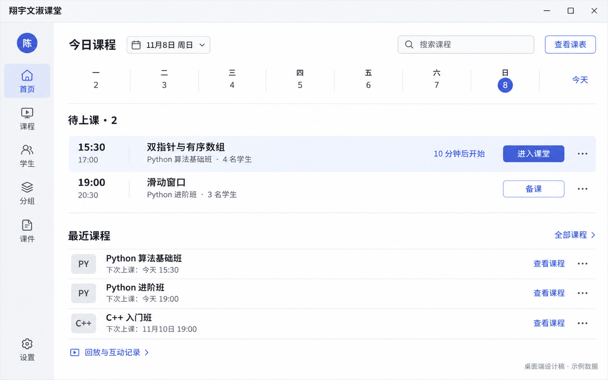
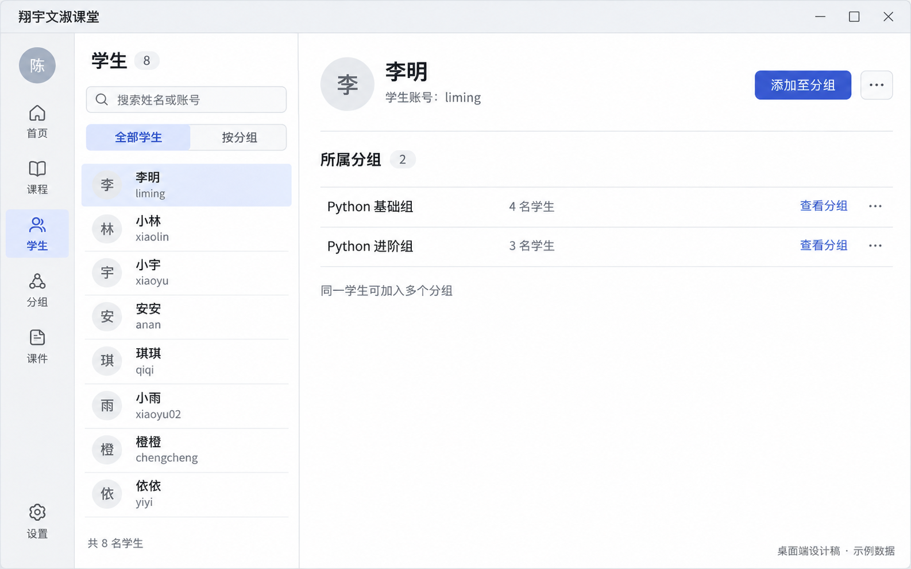
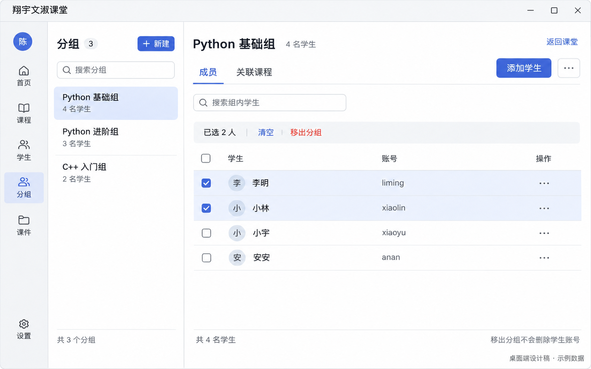

# 桌面端首页、学生、分组 · 简约清晰方案 v3

2026-11-08。此次修订只覆盖桌面客户端三个页面，参考 ClassIn 的紧凑列表与成员组织方式，保留浅色、克制配色。图片均为内置 image_gen 生成的示例设计，未替换程序界面，未改动网页、服务端或移动端。

## 首页：找到课程并进入课堂

窄导航、紧凑周日期条和今日待上课列表。下一节课突出“进入课堂”；后续课节提供备课；近期课程提供课程详情和回放入口。首页不同时展示学生名单、分组管理或常驻完整月历。

## 学生：以个人为中心的通讯录

左侧搜索学生，右侧显示选中学生的账号和所属分组。“添加至分组”直接作用于该学生。学生可属于多个分组；通讯录对当前教师可管理分组的学生去重，不等同于全站用户目录。查找账号不应默认把陌生账号加入任何分组。

## 分组：以集合为中心的成员管理

左侧切换分组，右侧查看组内成员及关联课程入口。添加学生是主要操作；选择成员后出现批量移出。移出改变分组关系，不删除账号，也不自动移出其他分组。

## 交互和视觉约定

- 导航统一为首页、课程、学生、分组、课件，带可读名称。学生与分组分别可达，避免在同一大页面中堆叠全部任务。
- 全局导航按约 76px 逻辑宽度实现；通讯录列表约 280px，分组列表约 250px。图像比例只作参考，实际组件按逻辑尺寸和字体测量。
- 字号：正文 13–14px，页面标题 18–20px，辅助信息不小于 12px。常规列表行高 44–48px，点击区至少 32–36px；使用系统文字缩放时允许行高增大。
- 强调色 #4768CF，正文 #252932，次要信息 #626975，背景 #FAFBFC，辅助区域 #F2F3F5。按钮用统一纯色，避免照搬生成图中的细微渐变、图标差异和头像颜色差异。
- 每个任务区域只突出一个主要操作，其余放在有明确可访问名称的更多菜单中。鼠标悬停和键盘焦点都能发现这些操作。
- 在 1024px 窗口下保留主要操作，详情区必要时切为前进/返回式单区布局；不能整体缩小文字来容纳多栏。
- 姓名、账号、分组人数、课程状态与日期必须来自真实数据。此套示例中有 8 个独立学生、3 个分组，成员数为 4/3/2；李明属于两个分组，因此关系总数为 9，学生总数为 8。
- 选中成员前不显示批量移出条。移出前确认数量和分组，失败保留选择；关联课程入口须按现有接口和权限逐项接入。
- 加载、搜索无结果、空学生目录、空分组、同步失败、权限不足都要有明确状态。重复命令、慢请求、过期版本和切换账号不能产生错误的成功提示。

## 设计检查与生成记录

已检查三个输出中的任务分工、名称与人数对应关系，以及学生/分组两页的独立入口。PNG 不是可交互原型，键盘、尺寸适配与真实接口行为须在实现后验证。完整提示词保存在 [prompts.md](prompts.md)，工具为内置 image_gen，无 CLI 或 API 密钥。

功能结构参考 [ClassIn 班级管理官方说明](https://docs.eeo.cn/product/zh-hans/function/3ClassInIM.html)。这里的“分组”是本项目的学生集合，不能直接等同于 ClassIn 班级或课程；保留现有服务端边界。
