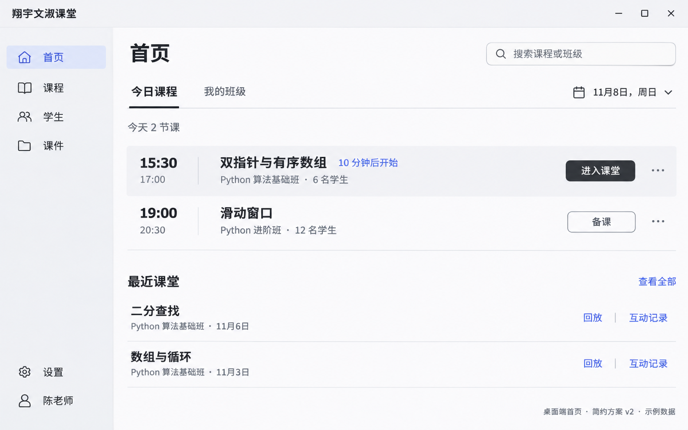
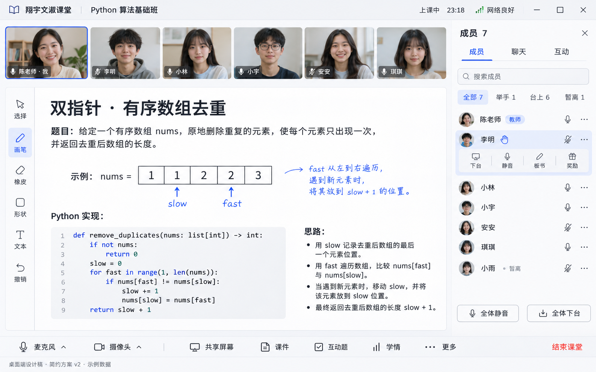
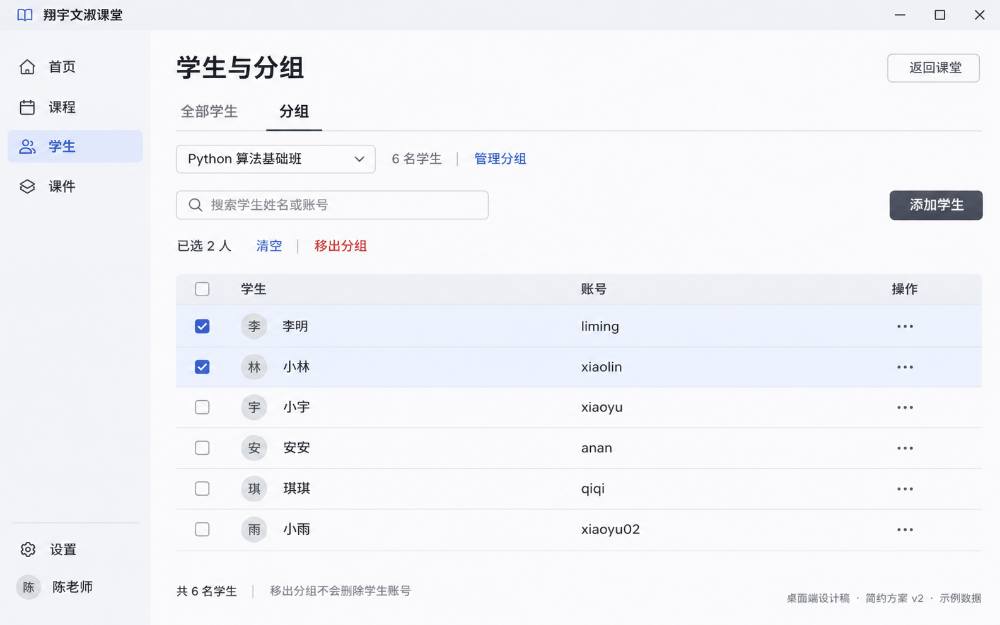

# 桌面客户端 · 简约方案 v2

2026-11-08。响应用户“简约时尚、功能明晰”的要求，替换 v1 的视觉方向。范围仅为桌面设计，未改动运行界面、移动端、网页与服务端。图片中的人物、课程与状态均为生成示例，不代表已接入真实业务数据。

## 首页

首页以找到当天课程并进入课堂为主任务。常驻区域从四列减为导航与内容两区；班级列表收进“我的班级”，完整日历收进日期入口。下一节课使用唯一突出的主按钮，备课、回放与互动记录按课节类型出现。

## 课堂

保留顶部视频座位、主教学画布、教学工具与成员面板的功能结构。外壳改为浅色，默认教学画布采用白板；颜色用于选中、批注和状态。默认仅打开成员、聊天、互动中的一个侧栏，允许收起。老师本地摄像头仍固定第一席；共享桌面内容不能替换 camera 预览轨道。

## 学生与分组

分组由下拉切换，不再常驻额外的树状分组栏。当前分组名称与人数只显示一次，学生表格省去重复的分组列。批量操作仅在选择学生后出现。添加学生为主操作，移出分组保留明确文字和确认。

## 规范与生成记录

[DESIGN.md](DESIGN.md) 规定配色、尺寸、交互和实现边界；[prompts.md](prompts.md) 保存三个界面的完整原始提示词。使用内置 `image_gen` 生成，未使用 CLI 或 API 密钥。生成图中的字体、图标和像素颜色只作参考，实施时统一为代码中的字体、图标库和设计变量。

本轮评审：已经对比三个输出，检查核心入口、老师自览、分组选择与批量移出是否可见，确认不存在旧版深色边栏和亮绿色强调。生成图并非可交互程序，键盘、弱网、真实视频和窗口尺寸行为须在代码实现后验证。v2 为本轮修订稿，不能把生成图片直接用作运行界面。
