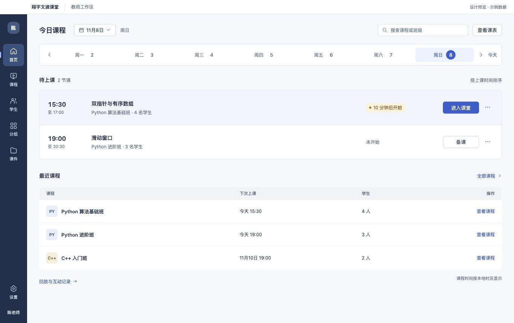
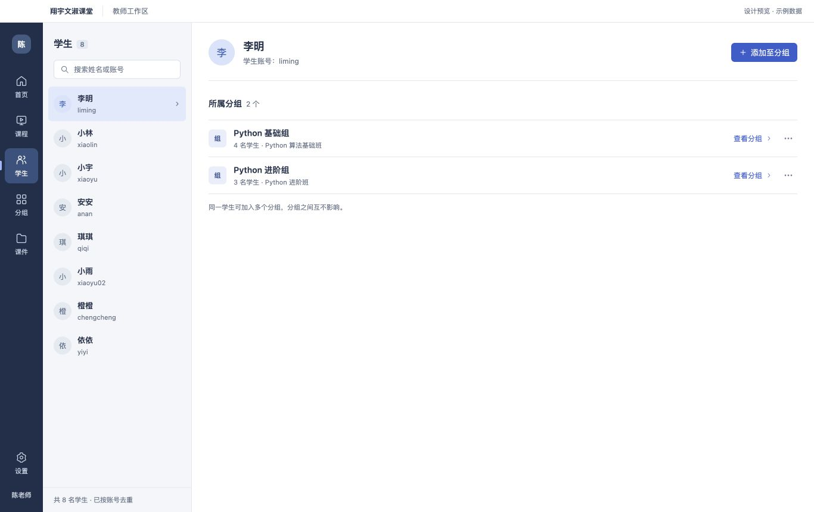
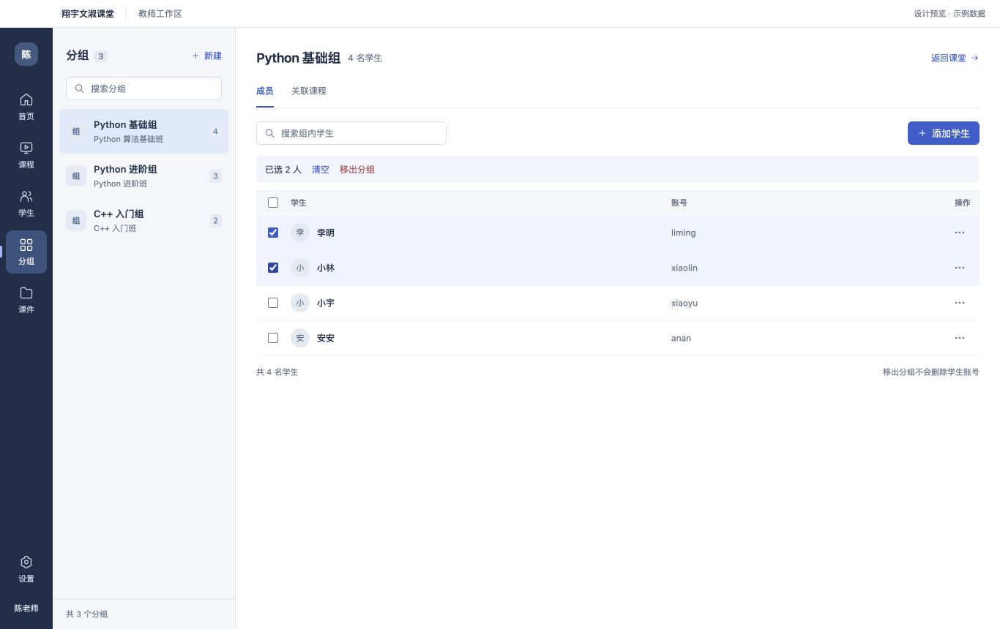

# PC 原型 v4：颜色层次与真实字号

2026-11-08。用户要求增加适度颜色对比、避免俗气，并缩小不符合 PC 的文字。此轮改为真实 HTML/CSS 原型，使用 Electron 独立窗口和共享 Chromium 预览核对尺寸，截图来自实际渲染，未使用图像生成来模拟字号。

范围仅在 `clients/desktop`。原型不连接生产接口，不读取登录会话，操作只改变页面内的示例数据，刷新即恢复。现有 Electron 课堂运行入口、移动端、网页和服务端未改变。

## 查看原型

```bash
cd clients/desktop
npm ci
npm run design:preview
```

独立 Electron 窗口为 1366×860，缩放为 100%，最小 1024×680。也可以直接在浏览器打开 [index.html](index.html)，或启动本地静态服务。此次会话的临时服务为 `http://127.0.0.1:3182/`，不属于线上部署。

## 页面

### 首页



下一节课保持唯一突出入口，临近上课状态使用小面积琥珀色；导航以墨蓝建立结构对比，主内容使用白色和浅冷灰。保留独立 Electron 原生窗口截图 [01-home-native@2x.jpg](01-home-native@2x.jpg)，其像素尺寸为 2732×1720，对应 1366×860 逻辑尺寸。其余主截图为 1366×860，便于直接比较文字密度。

### 学生



左侧搜索和选人，右侧显示账号及所属分组。可从学生详情直接跳到分组，或选择多个分组加入。此原型中的通讯录是当前分组成员的去重合集，添加和移出都不创建或删除真实学生账号。

### 分组



支持新建本地示例分组、搜索组内学生、批量选择、确认移出、添加学生、查看关联课程。已在分组的学生不可重复加入。首页进入课堂、备课、课件预览和设置为明确标注的示例操作，不会打开真实音视频课堂。

## 样式实测

| 项目 | 实际样式 |
| --- | --- |
| 正文基准 | 13px |
| 主页面及详情标题 | 18px |
| 分组表格文字 | 12px |
| 分组成员行高 | 48px |
| 全局导航宽度 | 72px |
| 普通按钮高度 | 32px |

次要账号、表头和非核心说明使用 11–12px。文字没有通过 transform 或页面缩放来压小。1366px 和 1024px 宽度均检查了横向溢出；1024px 分组截图见 [verification-1024-groups.jpg](verification-1024-groups.jpg)。

配色：导航 `#202F4A`，正文 `#23304A`，次要文字 `#606D83`，主要操作 `#365DCE`，页面底色 `#F7F8FB`，提示文字 `#87530E` 配浅琥珀底 `#FFF2D9`。不使用大面积高饱和底色或装饰性渐变。

主要文字对比度计算：正文/白底 13.18:1，次要文字/白底 5.23:1，导航文字/导航底 9.05:1，白字/主按钮 5.81:1，琥珀提示 5.79:1。控件提供明确名称、键盘焦点和图形/文字状态，不只依赖颜色。

## 已验证与边界

- Electron 原型成功打开并读取到首页；原生输入自动化未稳定控制该窗口，后续共享页面交互通过内置浏览器的同一份 HTML/CSS/JS 验证。
- 学生搜索“小宇”仅显示对应条目，选择后详情变为小宇；清空恢复通讯录。
- 选中两名学生后出现批量条；确认移出后组内人数从 4 变为 2；重新添加后恢复 4，已有学生被禁用避免重复添加。
- 1366px 实测正文 13px、详情标题 18px、导航 72px；1024px 实测表格行高 48px，首页及分组没有横向溢出。
- 静态语法检查覆盖 app.js 与 preview.cjs。原型不涉及真实账号、实时信道、摄像头、麦克风或屏幕共享验证，也不属于签名安装包发布。

后续落地须继续使用现有固定操作桥与服务端权限、版本校验，不能将本地示例数组或提示消息替代真实业务操作。
