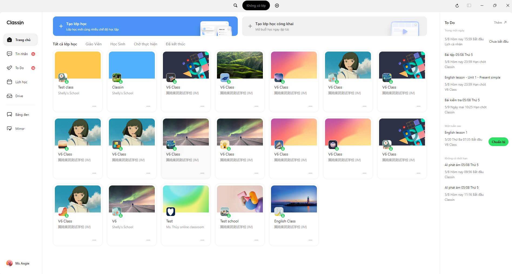
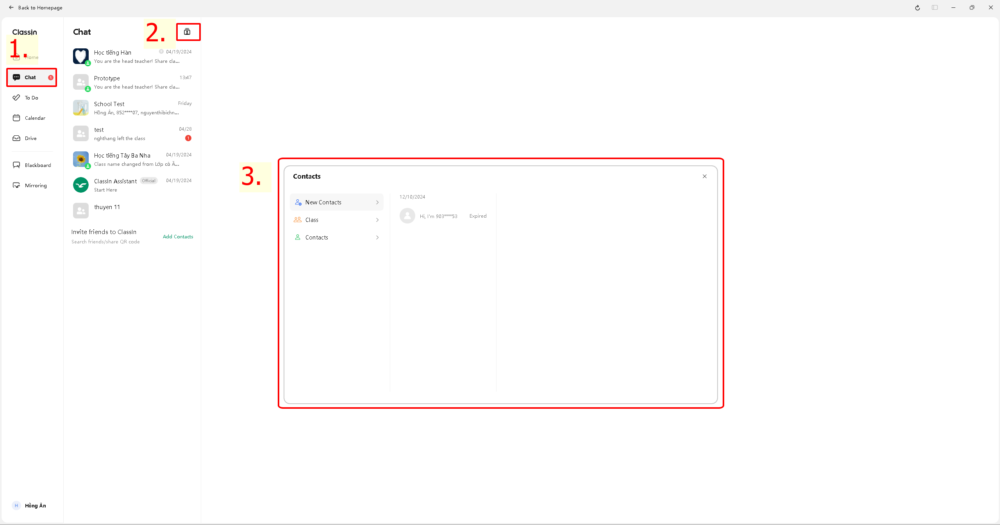
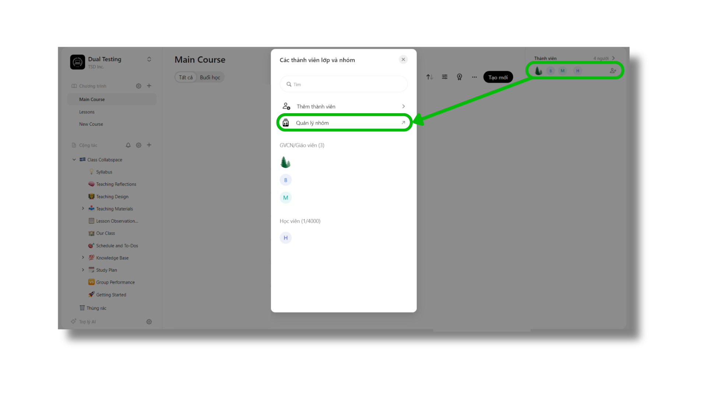
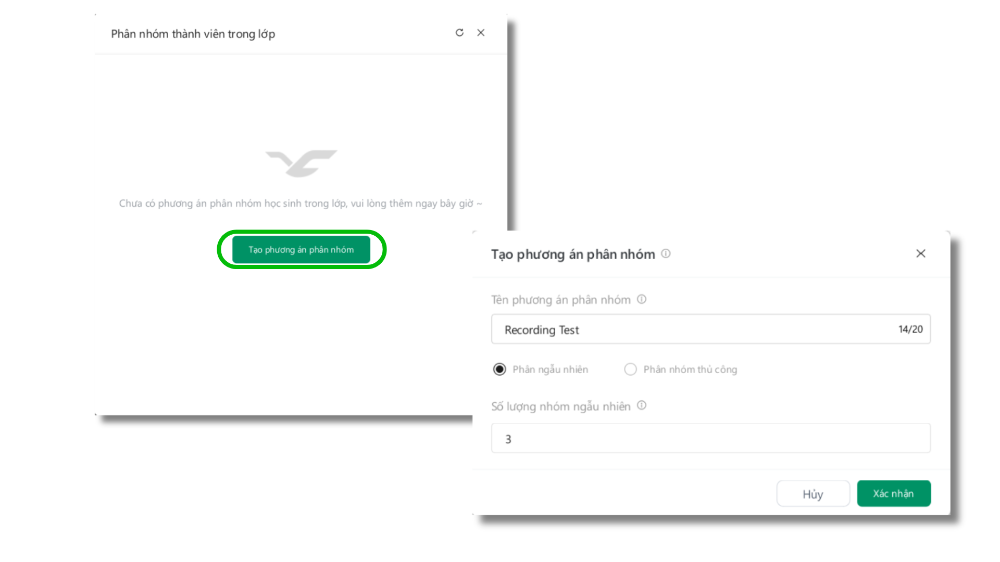

# ClassIn 桌面端调研 · 2026-11-08

状态：官网与公开截图调研已完成，用户已登录 Mac 客户端并已核对首页。联系人、班级成员和分组的原生操作待手动切换补充。随后用户要求直接截图并重新设计，已生成 [实拍参照 v5 原型](../../design/classin-v5/README.md)。以下继续区分有依据的观察与待核验项。

补充：已继续查看日历、To Do、Drive 与课节列表的发布者教程及原图，详见 [其他页面调研](other-pages.md)。当前 Mac 原生窗口可截图，但聚焦窗口后点击仍返回 `AXError.notImplemented`，这些补充页面未标为当前客户端实测。

## 证据范围

[ClassIn 官方下载页](https://www.classin.com/download/) 当前 Apple Silicon 入口提供 `6.0.9.3155`。已下载官方 DMG，以只读方式挂载并启动，bundle ID 为 `com.eeoa.classin`。应用内版本页尚未核验，版本号来自官网安装包名称。启动后曾出现原生读取超时，随后已成功读取用户登录后的首页截图；当前原生点击仍无法定位窗口，因此未宣称联系人和分组操作实测通过。

公开视觉证据来自 ClassIn Việt Nam（页面署名 EEO Việt Nam）的 6.0 首页、联系人和分组教程。下面截图是发布者原图，包含越南语/英语及发布者标注，不是我们生成的设计，也不是当前 Mac 客户端实测。来源与时间路径见 [source-manifest.json](source-manifest.json)。安装包不进入仓库。

## 当前 Mac 登录后首页：已实测

已在实际登录窗口中看到以下结构，未创建、修改或删除任何班级、成员或课程：

- 左侧为浅色导航，包含首页、消息、待办、日历、云盘；黑板和投屏位于分隔线下方，账号位于底部。
- 中间显示班级封面卡片，当前账号有 3 个班级。班级筛选采用顶部下拉，右上方为黑色新建班级按钮。
- 右侧为待办区域；当前无待办时使用独立空状态，并非日历或统计区。
- 顶部中央保留临近课堂提示位置，当前显示无课状态；搜索和加号为紧凑全局入口。
- 视觉基底是白与浅灰，颜色对比主要由班级封面提供。当前主要操作是黑色，不是我们 v4 的蓝色主按钮和墨蓝侧栏。
- 界面没有硕大的“首页”标题；班级名称与业务内容是视觉焦点。

本地原始截图保存在 `outputs/classin-research-2026-11-08/native-home.jpg`。它含真实账号、班级和机构信息，仅保留本机，不随 Git 提交。下面的版本化图片均来自发布者公开资料。

实际版本和公开图也有差异：公开图顶部是创建入口横幅与多个筛选标签；本次 Mac 窗口为简洁的筛选下拉和黑色新建按钮。因此不能逐像素照搬 2025 年公开图，也不能把它标作当前 Mac 实测截图。

## 首页：班级为主体，待办与课表各有位置

公开资料中的首页主体为班级入口，提供角色/状态筛选及创建入口；待办在右侧，课表有独立导航。顶部临近课程提示负责快速入课，而不是让整张日历成为默认首页。见 [新版首页说明](https://classin.vn/huong-dan/giao-dien-trang-chu-homepage/) 与 [6.0 更新说明](https://classin.vn/ban-cap-nhat-thang-6-2025/)。

**对当前方案的判断：**我们 v4 把“今日课表”当首页主体，是任务组织的自行改编，不能称为已对照 ClassIn 首页。下一轮需先决定首页的核心对象是班级还是课节，再安排日程入口。

## 学生/联系人：先找人，再操作这个人

6.0 教程的联系人入口位于消息区域，查找、好友与班级人员按对象分层。见 [联系人说明](https://classin.vn/huong-dan/danh-ba-contact-tren-ung-dung-classin-hoc-vien/)。

**对当前方案的判断：**可以借鉴搜索、名单、选中对象详情的结构；但“联系人/好友”不等同于“学生名册”。我们的学生来源、教师可见范围及分组权限必须保持原业务语义，不能为了外观照抄好友功能。

## 分组：班级内的教学组织，而非通用通讯录分类

公开教程从班级成员进入分组管理，先创建分组方案，再组织方案内的小组；支持随机或手动安排，并将小组用于教学活动。见 [分组管理说明](https://classin.vn/huong-dan/tao-nhom-hoc-vien-tren-ung-dung-classin-group-management/)。

**对当前方案的判断：**我们现有跨课程学生集合不等同于 ClassIn 班级内的教学分组。可借鉴左侧方案、右侧成员和按选中对象出现操作的交互；不能直接把两种数据模型合并。是否引入分组方案，应先明确教学用途和接口支持，不能在设计里暗示已实现。

## 视觉观察与前稿偏差

以下为根据公开截图作出的设计分析，不是 ClassIn 样式代码或真实逻辑尺寸的测量值。

| 方面 | 公开界面的观察 | 当前 v4 需要复核 |
| --- | --- | --- |
| 色彩对比 | 白/浅灰结构底色，内容封面提供较多颜色，按钮与提醒少量着色 | 墨蓝整条导航是我们自己的方向，并非该公开首页的主要特征 |
| 信息层级 | 小标题、细分隔、短标签及对象相关入口 | 不能只把字号调小，就认为已还原其层级 |
| 空间组织 | 首页的班级入口较密集；人员与分组在上下文中展开 | 应按任务使用空间，避免所有页面套同一课表或管理表格 |
| 功能显露 | 先选择班级/人/方案，相关操作随上下文出现 | 多个全局菜单和批量按钮需确认确实常用 |
| 提醒方式 | 待办、临近课程和角色标记有不同提示层次 | 不应把每种状态都做成同样的彩色标签 |

公开截图无法证明 ClassIn 当前 Mac 版本的精确字体像素、缩放比例和控件尺寸。我们 v4 的 13px/18px 是自己的实测值，不能写成 ClassIn 的实测字号。

## 当前版本实测清单

- [x] 官网页面、Apple Silicon 下载入口、文件版本名称与 bundle ID。
- [x] 新版首页、联系人与教学分组的公开流程和原图。
- [x] Mac 官网包登录后的首页布局、侧栏、班级卡片、待办空状态。
- [ ] 学生/联系人入口及教师账号可见权限。
- [ ] 班级成员、分组方案和当前版本菜单操作。
- [ ] 系统显示缩放、窗口尺寸和字体可读性对照。

已按用户后续指示截图，并生成实拍参照 v5 设计原型；尚未替换现有课堂运行界面。首页已经可以依据当前版本纠正此前的结构偏差；联系人和分组仍待补充原生操作观察。后续应借鉴 ClassIn 的组织原则，同时保留本项目学生集合与课程权限的边界。
