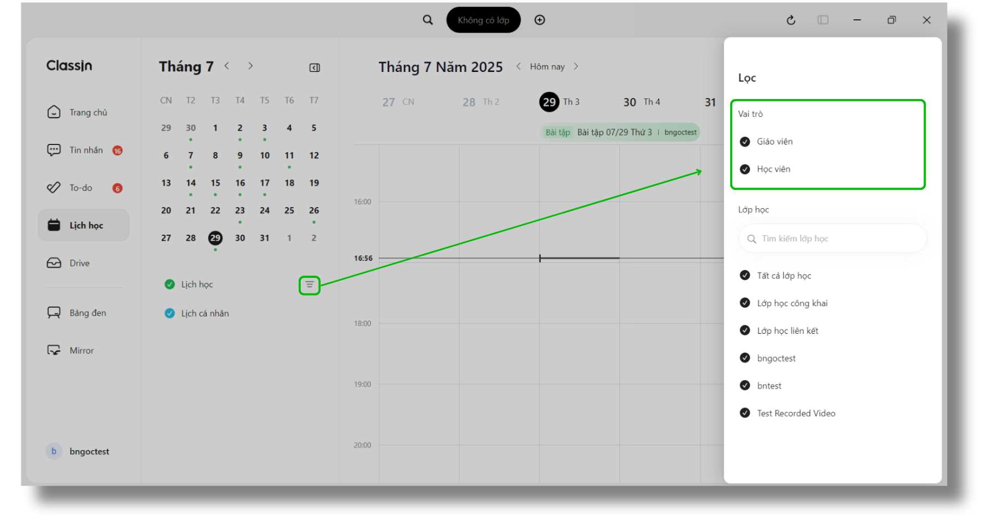
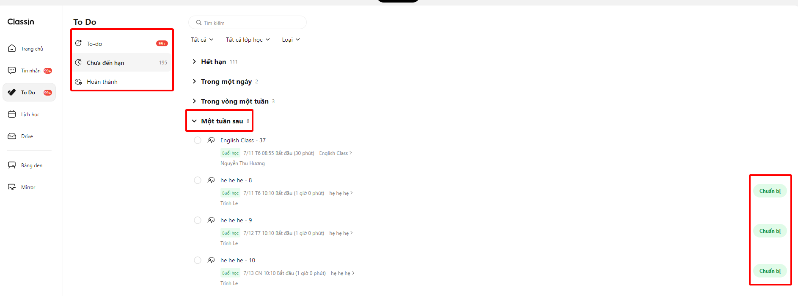
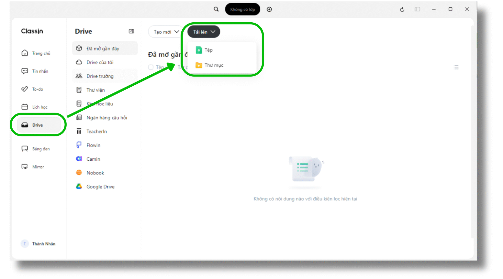
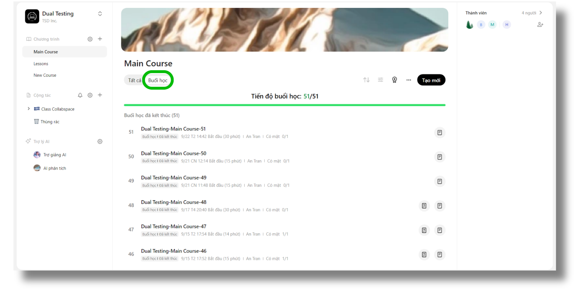

# ClassIn 其他桌面页面调研

调研日期：2026-11-08。范围为桌面客户端的日历、待办、云盘和班级内课节列表。本轮只补充调研，没有实现这些页面或改变线上业务。

证据来自 ClassIn Việt Nam / EEO Việt Nam 的公开教程及原图。当前 Mac 客户端仍停在已核对的首页；原生窗口可截图，执行窗口 Raise 后，导航点击仍返回 `AXError.notImplemented`。因此下文是发布者示例观察，不能作为当前 Mac 版本的操作验证。图片路径时间也不能证明客户端版本。原图来源记录在 [清单](source-manifest.json)。

## 日历：小月历定位日期，时间网格安排课节

示例中，主导航右侧是小月历，选中日期以黑底强调，有安排的日期使用绿色圆点；下方区分课堂日历和个人日历。主体以日期列和小时行组成时间网格，顶部有日期切换及“今天”。筛选抽屉提供教师/学生角色复选和班级搜索、多选。

来源：[查看日历教程](https://classin.vn/huong-dan/xem-lich-hoc-tren-ung-dung-classin/)。另有 [入口说明图](sources/calendar-entry-publisher.png)，它实际展示的是首页入口，不能误当成日历主体截图。

**对本项目的设计建议：**日历应是独立导航页；紧凑小月历加周时间网格，优先显示课节名、时间和状态。使用少量颜色区分日程类型，保持正文 13px 的现有 PC 规范。点击课节后再展示详情和入课操作。此为我们的设计建议，不代表已经核实 ClassIn 点击后的全部行为。

## To Do：按状态切换，再按时限展开任务

二级导航分为待处理、未开始、已完成，旁边显示数量；主体顶部是搜索、角色/班级/类型筛选。列表按时限折叠分组，任务行将名称放在第一层，类型、时间、所属班级和人员放在次要层，操作在最右侧。

教师教程说明教师与学生操作不同，不能直接复制学生的“开始/准备”按钮给教师。学生教程说明可通过任务操作或手动勾选归入完成。首页待办侧栏只呈现仍在期限内的任务；完整 To Do 页面保留更多任务供查看。

来源：[教师 To Do 教程](https://classin.vn/huong-dan/tong-hop-cac-tac-vu-can-lam-to-do-tren-classin/)、[学生 To Do 教程](https://classin.vn/huong-dan/tong-hop-cac-tac-vu-can-lam-to-do-tren-ung-dung-classin/)。[教师文章的示例图](sources/todo-teacher-publisher.jpg)仍出现学生任务按钮，是混合角色示例，不能单凭图片判断教师权限。

**对本项目的设计建议：**待办聚合待批改、待发布和即将上课等真实业务任务，按角色显示动作；首页侧栏只做摘要，点击进入完整列表。任务完成应以业务提交成功为准，不能仅隐藏行就表示作业或考试完成。搜索建议忽略大小写，不必照搬教程中的旧搜索限制。

## Drive：分类与文件列表，操作集中在顶部

二级导航中有最近打开、个人云盘、机构云盘等分类，主体上方是新建、上传和列表工具；上传菜单区分文件与文件夹。公开教程指出机构资源需要管理员授权。

来源：[Drive 教程](https://classin.vn/huong-dan/o-luu-tru-du-lieu-drive-tren-ung-dung-classin/)。

**对本项目的设计建议：**先围绕备课文件、课堂资料和最近使用组织页面，采用文件列表及按需预览。机构权限和外部存储集成需要真实接口支持，不能因为参考图中存在入口就宣称本项目已接入。

## 课节列表：在班级内切换课程，再看教学进度

左侧为班级及其课程目录，中间为课程内容、进度与课节列表，右侧是班级成员摘要。教程说明进行中/即将开始的课节按开始时间正序排列，结束课节按时间倒序排列；回放与报告入口附着在具体课节上。

来源：[查看课节列表教程](https://classin.vn/huong-dan/xem-danh-sach-bai-hoc-tren-classin/)。

**对本项目的设计建议：**班级、课程、课节保持明确层级；回放、课堂互动记录和教学统计随课节进入。老师查看全班、学生仅查看自己的数据仍由本项目权限控制，本轮没有验证 ClassIn 是否提供相同互动回看范围。

## 后续设计顺序

1. 独立日历页：日期定位、周视图、班级筛选、课节详情。
2. 完整待办页：首页摘要联动、角色动作、状态及截止时间分组。
3. 班级内课程/课节页：成员、上课、回放与互动统计入口。
4. 云盘页：备课和课堂资料的查找与复用。

共同原则是白/浅灰结构底色、紧凑文字、细分隔线，颜色用于内容和状态；页面结构应跟随任务，不将所有页面统一套成班级封面卡片。
